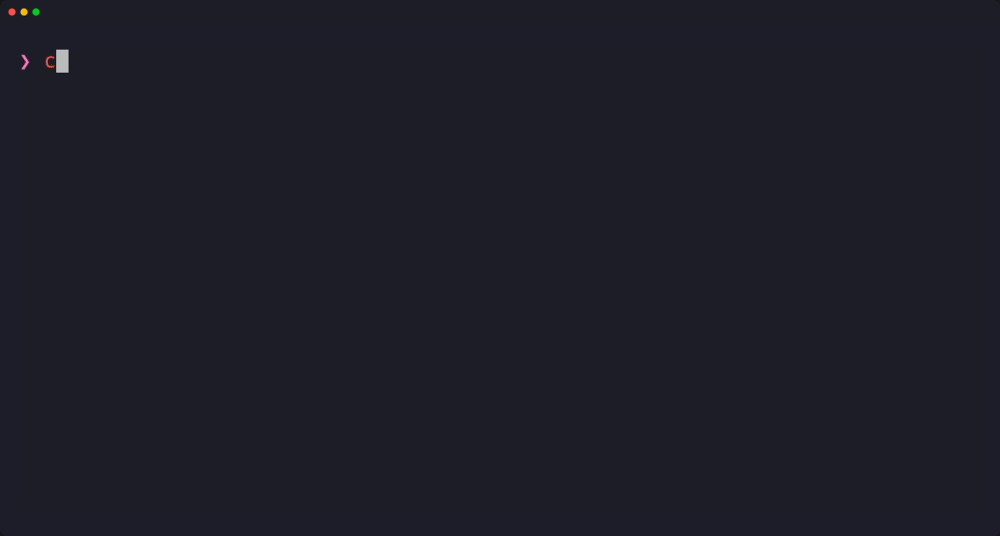
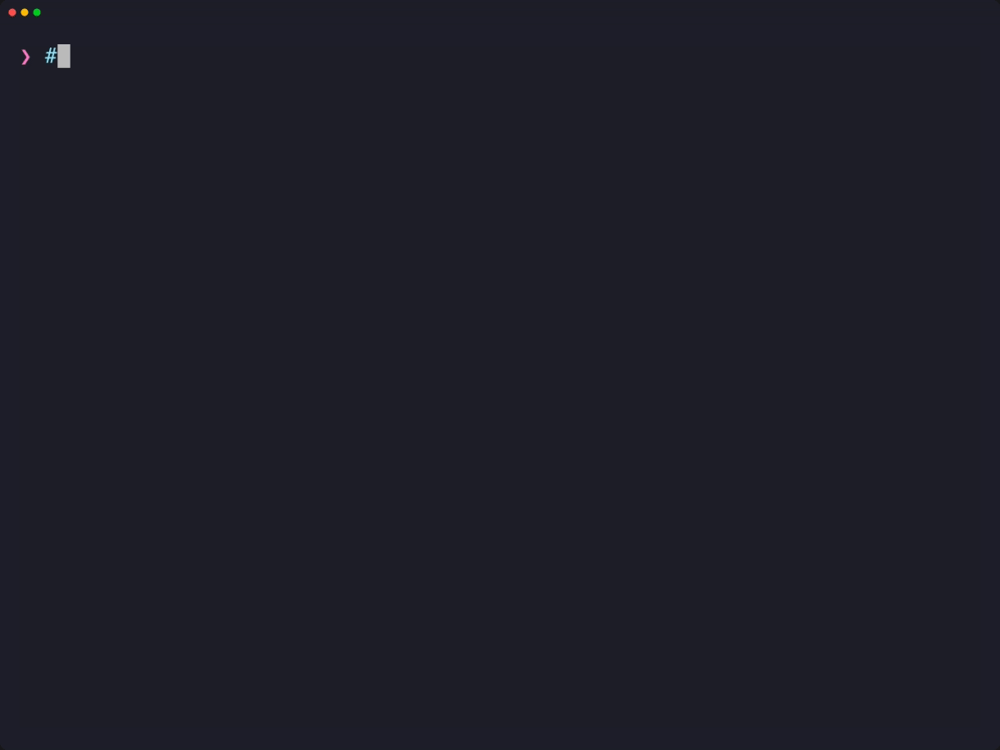

# deem

`deem` asks a question about every line of input, or every picture, and acts on the answer. It works like `grep`, but it matches on meaning instead of keywords. It uses [Jev](https://docs.typesafe.ai), TypeSafe AI's hosted model, or an open model you run on your own machine.

<p align="center">
  
</p>

## Install

```sh
cargo install --locked --git https://github.com/phyro/deem
```

Building needs Rust 1.89 or newer ([rustup](https://rustup.rs)). Then add a model to ask, hosted or your own. The first API added is the default, and `--api NAME` picks another for a run.

### Jev, hosted

Get an API key from [TypeSafe AI](https://docs.typesafe.ai). `deem api add` asks for it and keeps it in `~/.local/state/deem/keys/jev`, a file only you can read (`JEV_API_KEY` in the environment works too, while no API is added):

```sh
deem api add jev https://api.typesafe.ai/v1 --pictures --key
```

### A model of your own

llama.cpp's `llama-server` runs [Kev](https://github.com/jaredpalmer/kev), which reads text, or vllm-d3-mini, which reads pictures too; both are Apache-2.0 models, behind the same API as Jev's. llama-server comes with [llama.cpp](https://github.com/ggml-org/llama.cpp): take a [release](https://github.com/ggml-org/llama.cpp/releases) built for your system and GPU, or install it with a [package manager](https://github.com/ggml-org/llama.cpp/blob/master/docs/install.md). It downloads a model from Hugging Face the first time, needs no key, and your records stay on your machine. Neither model is Jev, and their scores differ from the ones shown here (Kev's are lower), so check a threshold on yours. The manual's [A server of your own](docs/MANUAL.md#a-server-of-your-own) says what the picture proxy changes and why d3-mini needs `-b` and `-ub`, lists the sizes and quantizations there are, and shows how to compare a model's answers with Jev's.

#### Kev

Kev reads text:

```sh
llama-server -hf ggml-org/Kev-4B-GGUF:Q8_0 --host 127.0.0.1 --port 8010 -ngl 99
deem api add kev http://127.0.0.1:8010/v1 --model kev-latest --parallel 4
```

#### d3-mini (with picture support)

d3-mini reads text and pictures. llama-server takes pictures in another form than deem sends them, so a small proxy sits between the two: [`pictures.py`](https://gist.github.com/phyro/a4be45fc76e1bb879de6c63c40a42681) (Python 3, nothing to install). Save it, start llama-server and the proxy, each in a terminal of its own, and add the proxy as the API:

```sh
curl -L -o pictures.py \
  https://gist.github.com/phyro/a4be45fc76e1bb879de6c63c40a42681/raw
llama-server -hf ggml-org/vllm-d3-mini-GGUF:Q8_0 --host 127.0.0.1 --port 8012 \
  -ngl 99 -b 8192 -ub 8192
python3 pictures.py http://127.0.0.1:8012 --port 8013
deem api add d3 http://127.0.0.1:8013/v1 --model jev-latest --pictures \
  --parallel 4
```

## Usage

```
deem QUESTION [FILE...]              keep lines where the answer is yes
deem QUESTION -p [FILE...]           score<TAB>line, every line
deem QUESTION -o A,B,C [FILE...]     option<TAB>line: the best fit
deem QUESTION -l A,B,C [FILE...]     level<TAB>line: 0 is A, 1 B, ...
deem run PROGRAM [ARG...] [FILE...]  group, histogram, ... or yours
deem tune QUESTION [FILE...]         label some lines, get a threshold
```

Input comes from files or stdin, one record per line; with `-J`, each JSON value is a record. A PNG or JPEG file is a picture, and one record. `-t N` sets the threshold (default 0.5). `deem --help` and [the manual](docs/MANUAL.md#reference) list every option.

## Examples

The examples below run as written from [`examples/`](examples/), in a clone of the repo: `git clone https://github.com/phyro/deem && cd deem/examples`. Their scores are Jev's, and vary a little between runs.

**Semantic grep.** In [`feedback.txt`](examples/feedback.txt), `grep` finds one line, and it is the one that isn't a complaint:

```console
$ grep -i problem feedback.txt
no problems since the update, great job
```

deem keeps the six lines that report a problem, whatever words they use:

```console
$ deem "is the user reporting a problem?" feedback.txt
charged twice for one order??
the checkout page keeps spinning forever
you took my money two times
can't log in with Google
checkout stuck on the loading screen
double payment on my card
```

**Rank by score.**

```console
$ deem "is the user reporting a problem?" -p feedback.txt | sort -rn
0.95	double payment on my card
0.93	charged twice for one order??
0.91	can't log in with Google
0.88	the checkout page keeps spinning forever
0.86	checkout stuck on the loading screen
0.84	you took my money two times
0.12	how do I change my email
0.05	no problems since the update, great job
0.03	love the new dark mode
```

**Set the threshold.** A question keeps the lines scoring above 0.5; `-t` moves that line. At 0.9, only the three clearest complaints are kept, in their input order:

```console
$ deem "is the user reporting a problem?" -t 0.9 feedback.txt
charged twice for one order??
can't log in with Google
double payment on my card
```

**Classify, and anything that outputs lines.**

```sh
deem "what kind of message is this?" -o bug,billing,praise,question feedback.txt
deem "how urgent is this?" -l "can wait,this week,now" tickets.txt | sort -rn
git log --oneline | deem "is this a breaking change?"
deem "is this urgent?" tickets.txt | deem "is this about billing?"
```

`-t` filters; `-p`, `-o` and `-l` label. They print every line, so rankings and counts see the whole input, and `-t` doesn't go with them. To keep only the lines above a threshold, leave out `-p`; to keep the lines with their scores, filter the scores: `deem "…" -p feedback.txt | awk '$1 > 0.8'`.

## Pictures

Pictures use the Jev API's image support, which is in beta: the API may still change how it takes them, and deem with it.

A PNG or JPEG file is one record, printed as its path. `grep` can't read a screenshot; deem can, and a page that only mentions errors isn't one that shows one:

```console
$ deem "does the screenshot show an error?" -p screens/*.png
1.0	screens/checkout-error.png
0.03	screens/loading.png
0.03	screens/orders.png
0.04	screens/orders-unstyled.png
0.03	screens/status.png
```

`--img NAME FILE` gives a program a picture of its own, such as a baseline to compare each screenshot against:

```console
$ deem run --img baseline screens/orders.png '{screen: ., same: ask(
    "does `screen` look like `baseline`, with the same layout and styling?";
    {screen: ., baseline: $baseline})}' screens/orders*.png
{"screen":"screens/orders.png","same":0.73}
{"screen":"screens/orders-unstyled.png","same":0.01}
```

`box(q; .)` finds where in a picture something is (it needs Jev 1.14, which `jev-latest` was on 2026-10-22; a model that refuses it says so, and `deem api edit jev --model jev-preview` is 1.14), and `-I` reads pictures' paths from stdin. The manual's [Pictures](docs/MANUAL.md#pictures) has the limits, the cost, and how to prepare files.

## Programs

Everything `deem run` runs is a program in [jq](https://jqlang.org/)'s language, built in; you don't need jq installed. A program runs once per record, with `.` the record. deem adds four functions:

- `ask(question; context)`: a yes/no score from 0 to 1
- `choose(question; [options]; context)`: one of the options
- `rate(question; [levels]; context)`: a level on a scale, `0` the lowest
- `box(question; context)`: where in a picture, `{top, bottom, left, right}`

The context is all the model sees: `ask(q; .)` sends the whole record, `ask(q; .body)` only its body. Nothing is sent that the program doesn't name.

**Either of two questions.**

```sh
deem run 'select(ask("is this urgent?"; .) > 0.8
             or ask("is the sender a paying customer?"; .) > 0.8)' tickets.txt
```

**The next question depends on the first answer.**

```sh
deem run '
  choose("topic?"; ["bug", "billing", "other"]; .) as $topic
  | if $topic == "bug" then
      select(ask("is it blocking the user?"; .) > 0.8)
    elif $topic == "billing" then
      select(ask("is the user asking for a refund?"; .) > 0.8)
    else empty end' tickets.txt
```

**JSON records.** Ask about one field, keep the whole record, or add the answer to it:

```sh
deem run -J 'select(ask("is this urgent?"; .body) > 0.8)' tickets.jsonl
deem run -J '.topic = choose("topic?"; ["billing", "bug", "other"]; .body)' \
  tickets.jsonl
```

Questions that don't depend on each other go to the model together, so a program costs round trips only where it needs an answer before it can ask the next question.

A program worth keeping goes in `.deem/NAME.deem` (a project's) or `~/.deem/NAME.deem` (yours), and runs by name. This one keeps the threshold `deem tune` found:

```sh
mkdir -p .deem
cat > .deem/problem.deem <<'END'
module {input: "each", defaults: {threshold: 0.7}};
# problem: messages that report a problem (threshold from deem tune)
def main: select(ask("is the user reporting a problem?"; .) > $threshold);
END
deem run problem feedback.txt
```

The manual's [Programs are jq](docs/MANUAL.md#programs-are-jq) covers arguments and named values, reading every record at once, how questions are batched, and where jq and deem differ.

## Grouping similar lines: `group`

`sort | uniq -c` groups lines that are identical; `group` groups lines that mean the same, as your question defines it:

```console
$ deem run group "is this the same issue?" feedback.txt
1	charged twice for one order??
1	you took my money two times
1	double payment on my card
2	the checkout page keeps spinning forever
2	checkout stuck on the loading screen
3	can't log in with Google
4	love the new dark mode
5	no problems since the update, great job
6	how do I change my email
```

Groups print one after another, numbered in the order their first line appears; within a group, lines keep their input order. `grep '^1	'` picks out one group, and `cut -f1 | uniq -c` counts each.

How it works: the first line becomes group 1, and every other line is asked, all at once, whether it is the same as that one. The first line left becomes group 2, and so on, up to 20 groups (`--arg groups N` sets another limit); the lines left print under `-`. A run costs up to a request per line per group, so run it on a sample. Your question decides what "the same" means: "the same issue", "the same tone" and "the same customer" group the same lines differently.

## Getting a question right

The wording of a question matters, and so does the threshold, which depends on the question and the data. Try both on a random sample, saved so every attempt sees the same lines (`shuf -n 300 tickets.txt > sample.txt`):

1. `deem run histogram Q sample.txt` (or `mix Q A,B,C`): does the question separate the lines?
2. `deem run disagree Q1 Q2 sample.txt`: where do two wordings decide differently?
3. `deem tune Q sample.txt`: where should the threshold be?

**Does it separate the lines?** `histogram` shows how the scores are spread:

```console
$ deem run histogram \
    "is something broken for the customer right now?" sample.txt
0.0	13	██
0.1	77	██████████
0.2	33	████
0.3	9	█
0.4	16	██
0.5	10	█
0.6	14	██
0.7	23	███
0.8	60	████████
0.9	45	██████
--------------------
above 0.5	152	████████████████████
baseline	0.36
```

Two clusters at the ends, with few lines between, mean the question separates the lines. Scores spread across the middle mean it is a judgement call, and any threshold there moves many lines. The baseline is the score for an empty line: well above 0, the question leans toward yes on its own.

**Where should the threshold be? `deem tune`.** A score of 0.6 can mean "yes" for one question and "not really" for another, and only you know which lines you want. `deem tune` asks you: it scores the input, shows you 20 lines spread across the scores, takes your yes or no for each, and suggests the threshold that agrees with you most.

<p align="center">
  
</p>

```console
$ deem tune "is the user reporting a problem?" sample.txt
Scored 300 lines. Showing 20 across the score range.

[1/20] 0.02  love the new dark mode, thanks!
  yes? [y/n/s=skip] n
[2/20] 0.87  the export button moved, took me a while to find it
  yes? [y/n/s=skip] n
...

Suggested threshold: 0.7 (17/20 agree with you)
  anything from 0.66 to 0.72 agrees as well
  0.7 would keep 181 of 300 lines

You and deem disagreed on:
  0.87  you: no   the export button moved, took me a while to find it
  0.81  you: no   I had a problem with login but it fixed itself
  0.47  you: yes  gift cards can't be used together with a coupon

deem 'is the user reporting a problem?' -t 0.7 sample.txt
```

The last line, on stdout, is the command to use. The disagreements often say more than the threshold: here a grumble, a problem that is over, and a limitation the model didn't count. No threshold fixes those; a sharper question can. `-n 50` labels more lines for a closer threshold. To keep the result, save it as a program ([Programs](#programs)).

## Output

The question forms and the built-in programs never change a record: they print it as it came in, or put their answers in columns in front of it. A program you write prints whatever it outputs, so it can transform records as any jq program does.

| You run | It prints |
|---|---|
| `deem Q` | the records where the answer is yes |
| `deem Q -p` | `score<TAB>record`, for every record |
| `deem Q -o A,B` | `option<TAB>record`, for every record |
| `deem Q -l A,B,C` | `level<TAB>record`, for every record: `0` is A, `2` C, and it can fall between two (`1.4`) |
| `deem run group Q` | `group<TAB>record` |
| `deem run disagree Q1 Q2` | `score1<TAB>score2<TAB>record`, where they differ |
| `deem run histogram Q`, `mix Q A,B` | a table |
| `deem run '…'` | what the program outputs, one value a line |

- The record is always the last column, so `cut -f2-` gets it back unchanged, even when it holds tabs (`cut -f3-` for `disagree`). A JSON record is printed on one line; a picture as its path.
- Records print in input order, so the output lines up with the input.
- stdout is the answer and nothing else; stderr is about the run: errors, warnings, and `--stats`.
- Exit codes follow `grep`: 0 when something was printed, 1 when nothing was, 2 on an error or a failed record.

## Before a big run

Every record is a request, about 80 a second at the API's default limit. Run on a sample with `--stats` first: it prints the requests, tokens and time the run took, and the same per 1000 records, to scale up from. `--max-questions` (default 100,000) stops a runaway run, `--failed FILE` keeps the records that didn't finish to run again, and `--trace FILE` records every question, wave and request. The manual's [Before a big run](docs/MANUAL.md#before-a-big-run) has more.

## More

- [docs/MANUAL.md](docs/MANUAL.md): the reference.
- [docs/DESIGN.md](docs/DESIGN.md): how deem works.
- [docs/TRANSPORT.md](docs/TRANSPORT.md): the rules deem keeps when it talks to the API.
- [ISSUES.md](ISSUES.md): what is known and not done.
- [`.claude/skills/deem-programs`](.claude/skills/deem-programs/SKILL.md): a [Claude Code](https://claude.com/claude-code) skill that writes deem commands; copy it to `~/.claude/skills/` to use it everywhere.

## Privacy

Every record deem asks about is sent to the model's API: to TypeSafe AI for Jev, or only to your server for a model of your own. Don't pipe in data you wouldn't send to a third party, and treat the answers as signals for triage rather than as decisions to act on automatically.
